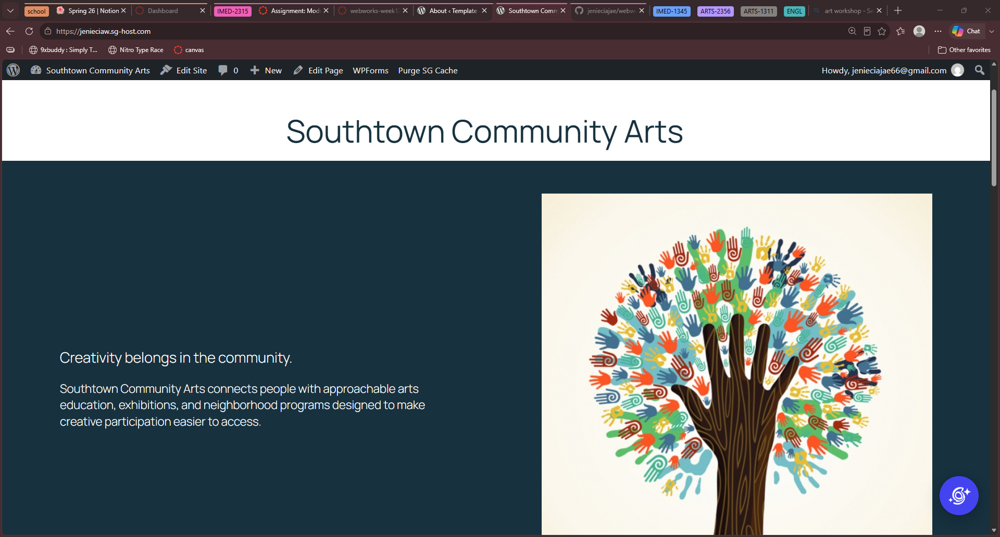
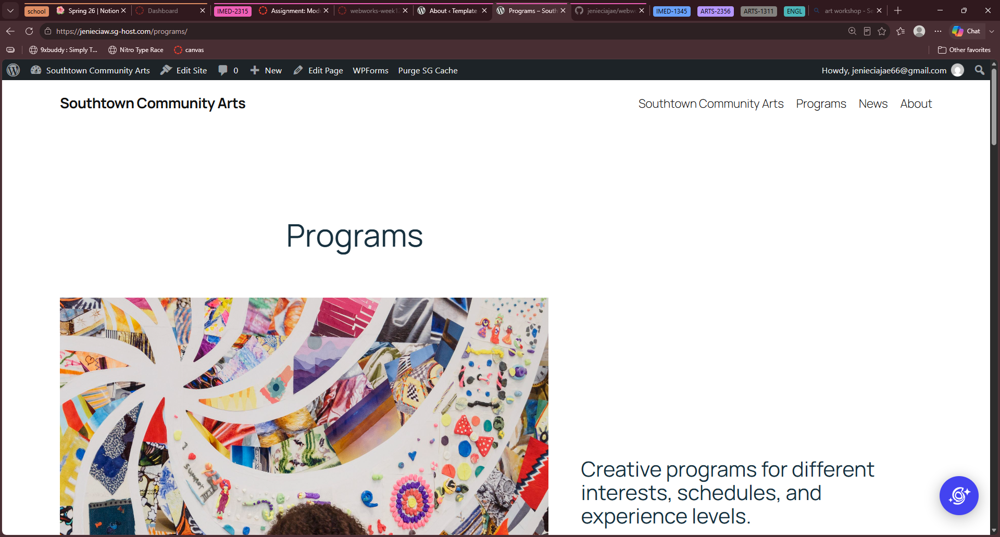
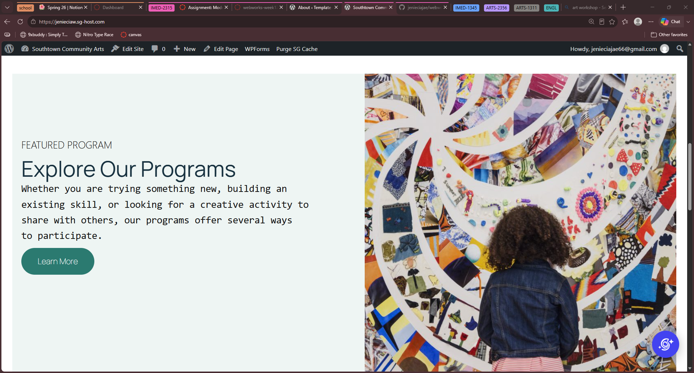
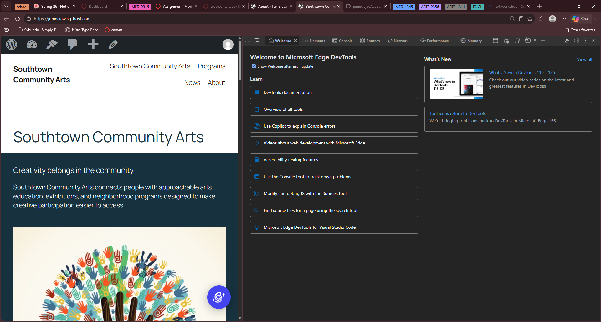
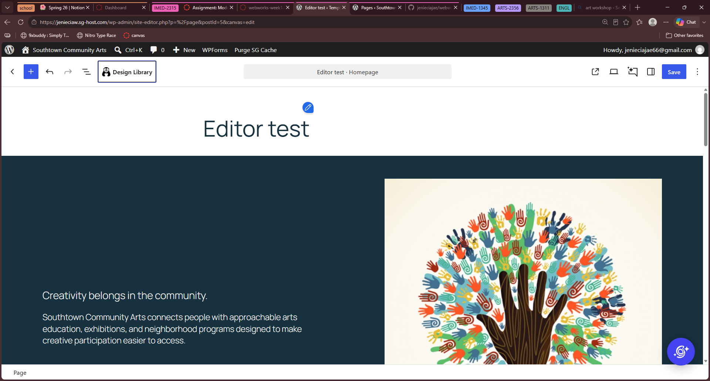

# Week 12: Customize the Experience — WordPress Development

**Client:** Southtown Community Arts  
**Role:** Junior WordPress Developer

## Project Overview

Briefly summarize how you customized the existing Week 11 CMS without making routine content harder for the client to maintain.

For Week 12, I continued customizing the Southtown Community Arts website from Week 11. I updated the global colors and typography, created a branded reusable pattern, and customized the footer to make the site feel more consistent. I focused on keeping the website easy to maintain so future editors can still update regular content through WordPress without needing to edit code.

---

# Customization Decisions

Document the four required decisions below.

## 1. Global Design System

**Requirement:**  
The Southtown brand colors and typography needed to stay consistent throughout the website.

**Location:**  
Appearance → Editor → Styles

**Change:**  
I added the Southtown brand colors to the Custom palette, including Southtown Deep (#17313f), Southtown Teal (#2b7a70), Southtown Warm (#c7855a), Southtown Soft (#eef5f3), and Southtown Paper (#ffffff). I also updated the typography to use Manrope, with a body line height of 1.5 and heading line height of 1.125. I updated the link styling to use teal with an underline.

**Why this level:**  
Using Global Styles makes it easier to keep the same colors and typography throughout the website instead of having to edit every page individually.

**QA:**  
I checked the website to make sure the colors and typography looked consistent and that text and links were readable.

---

## 2. Branded Reusable Pattern

**Pattern:**  
Southtown Program Feature

**Change:**  
I created a two-column pattern with an image on one side and program information on the other. I used the Southtown brand colors and added a heading, description, and Learn More button.

**Reuse:**  
I added the pattern to the Home page and checked that it displayed correctly. I also adjusted its width so it could stretch across the page.

**Editor value:**  
The pattern gives future editors a consistent layout they can reuse without having to rebuild the design from scratch. They can update the image and text while keeping the overall style consistent.

---

## 3. Site-Wide Structure Customization

**Shared area:**  
Footer

**Change:**  
I customized the footer by removing the instructional placeholder text and adding the footer navigation links: Home, About, Programs, and News. I also kept the dark Southtown Deep background with white text.

**Why this level:**  
The footer appears across the website, so it makes more sense to update it as a shared template part instead of making the same changes on individual pages.

**QA:**  
I checked the home page footer to make sure the navigation links and styling displayed correctly.

---

## 4. Controlled Development-Level Modification

Complete **one** option.

**Option used:**  
Targeted CSS

**Location:**  
Additional CSS in the WordPress editor.

**Code / configuration snippet:**

.wp-block-button__link:hover {
    background-color: #17313f;
    color: #ffffff;
    transition: background-color 0.2s ease;
}

**Reason:**  
I added a hover effect because I wanted the buttons to have a little more interaction when visitors move their mouse over them. This gives the buttons a clear visual change while keeping them consistent with the Southtown brand colors.

**Documentation:**  
WordPress documentation on Styles and custom CSS.

**QA:**  
I hovered over the buttons to make sure the background changed to Southtown Deep and the text remained white. I also checked that the buttons still worked normally.

---

# Visitor + Editor QA

## Visitor Experience

- [X] I tested narrow and wide viewport behavior.
- [X] I checked visual consistency on more than one page.
- [X] I checked text/link/button contrast.
- [X] I verified visible keyboard focus.
- [X] I tested navigation and links.
- [X] I checked that the brand system is consistent rather than page-specific.

### Visitor QA Notes
I checked the updated pages and footer to make sure the design stayed consistent. I also tested the button hover effect and keyboard focus to make sure interactive elements were still easy to identify.

## Editor Experience

- [X] Routine content is still editable through WordPress.
- [x] The branded pattern is understandable to reuse/edit.
- [x] My customization did not move ordinary client content into code.
- [X] I performed one temporary routine content edit, previewed it, and restored the original content.
- [X] The site remained visually coherent after the editor test.

### Editor QA Notes
I temporarily changed text on the Home page, previewed the update, and then restored the original wording. This confirmed that regular content can still be edited directly through the WordPress editor without changing the code.

---

# Evidence

Use the exact filenames below.

## Customized Home

## Customized Programs

## Branded Reusable Pattern

## Responsive / Mobile View

## Editor Maintainability Test

---

# Maintainability Reflection

Write approximately **75–100 words** responding to:

> Give one example of a change you intentionally handled globally and one change you intentionally left as editable content. How does that separation help Southtown Community Arts maintain the site without losing design consistency?

One change I handled globally was the brand colors and typography. This keeps the website looking consistent without having to update each page individually. One change I left as editable content was the program description on the Home page. This allows someone to update the wording or image directly in WordPress without needing to touch the code. Keeping design settings global while leaving regular content editable makes the website easier to maintain and helps prevent the design from becoming inconsistent.

---

# Final Handoff Check

- [X] I continued the Week 11 Southtown site rather than rebuilding it.
- [X] I applied the approved palette and typography direction systematically.
- [X] I used global controls for global decisions.
- [X] I created or significantly customized one branded reusable pattern.
- [X] I made one appropriate site-wide structure customization.
- [x] I completed exactly one controlled development-level modification.
- [X] I did not add PHP, plugins, custom blocks, or a child-theme build for this assignment.
- [X] Visitor and editor QA are complete.
- [X] All five evidence screenshots display in this README.
- [X] I completed the maintainability reflection.
- [X] I committed and pushed the Week 12 handoff folder.
