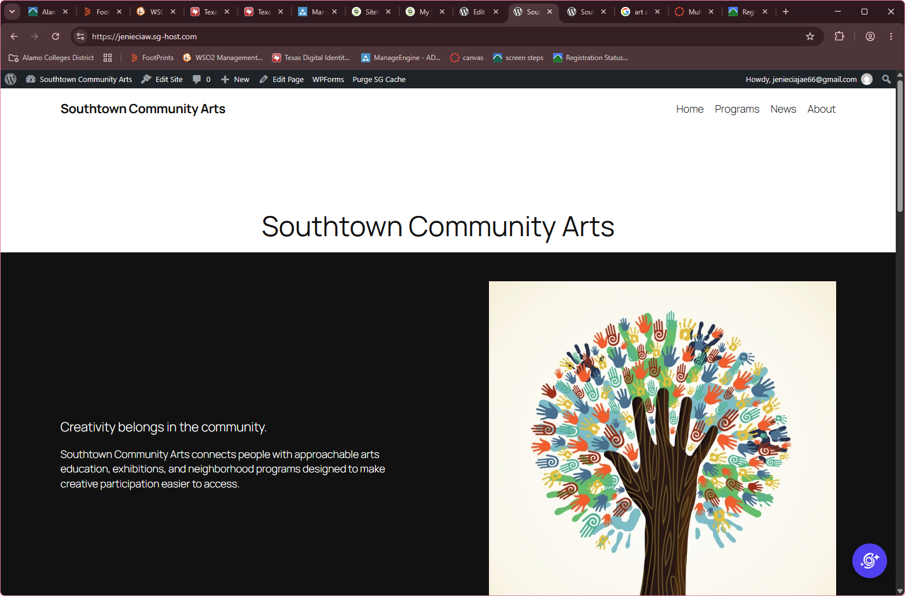
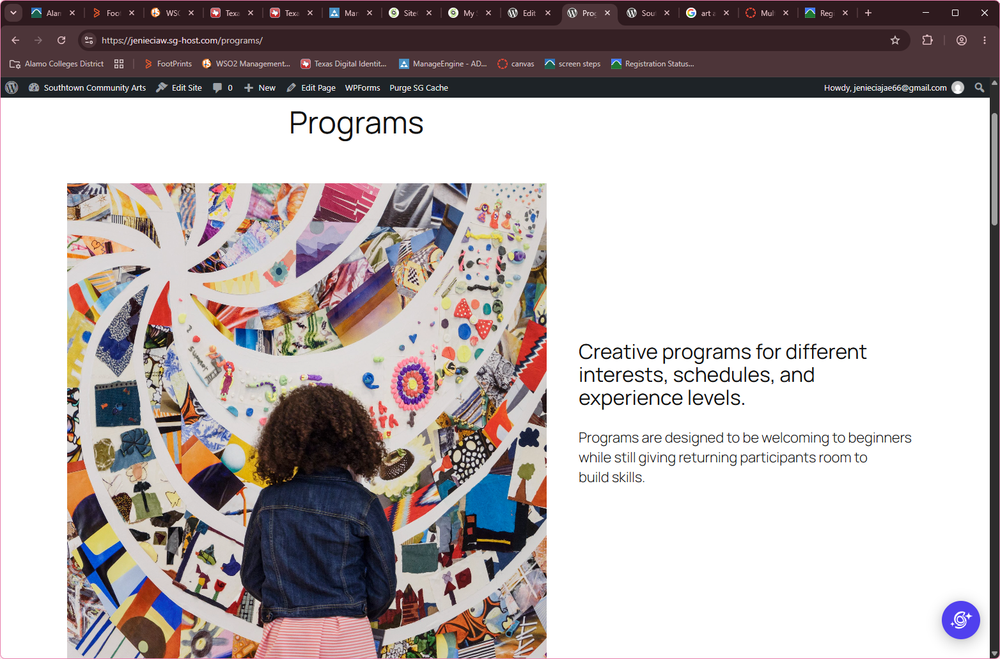
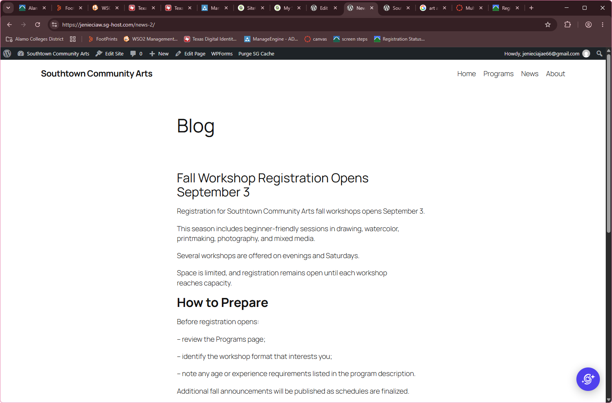
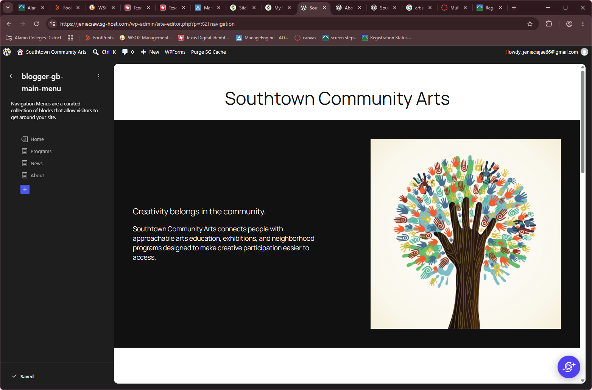
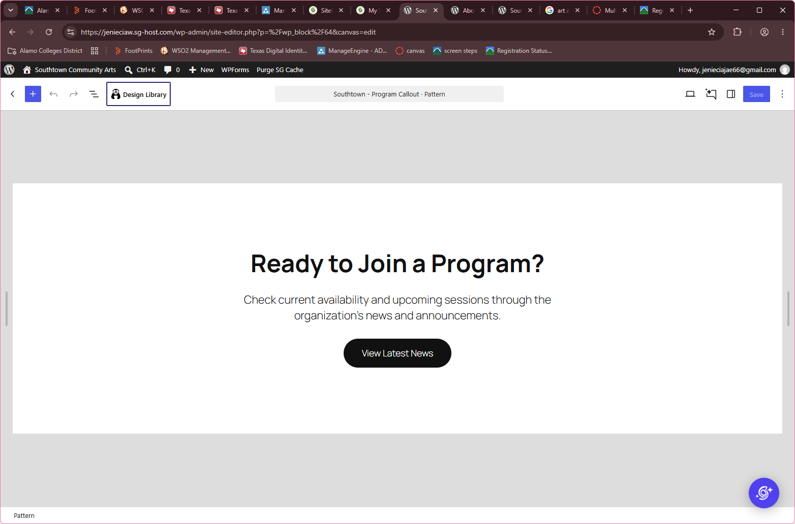
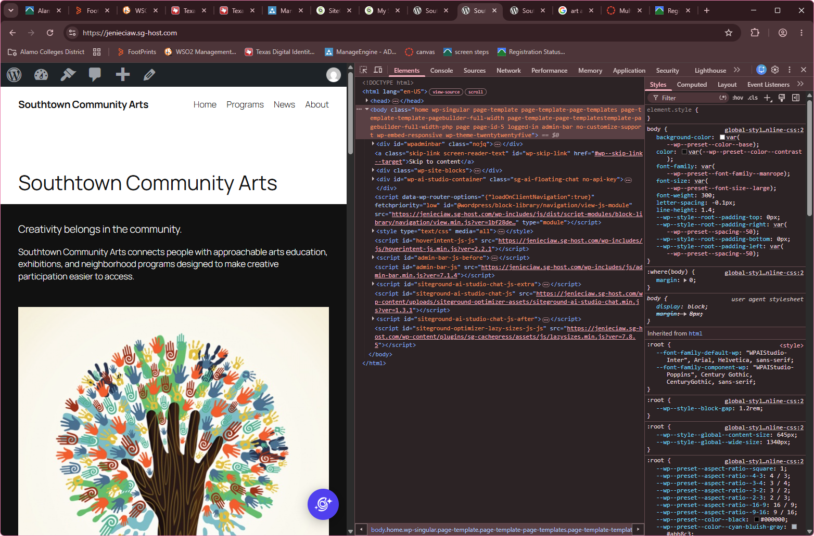

# Week 11: Build for Content — WordPress & CMS Fundamentals

## CMS Project Overview

**Client:** Southtown Community Arts  
**Role:** Junior Web / CMS Specialist  
**Week:** 11 — Build for Content: WordPress & CMS Fundamentals

For this project, I created a WordPress website for Southtown Community Arts using the content provided. I created the main pages, added a News post, set up the navigation, and made a reusable pattern. I also worked on the overall website layout and made sure the content was organized in a way that would be easy to update.

---

## WordPress Site Access

**Site URL or instructor-access information:**  
https://jenieciaw.sg-host.com/

---

# Content Architecture

Explain how you organized the supplied client content.

## Pages

List the Pages you created and briefly explain why they belong as Pages.

- **Home:** The main page where visitors can learn about Southtown Community Arts and what the organization offers.
- **Programs:** Shows the different programs and activities that visitors can learn more about.
- **About:** Gives visitors more information about the organization and its purpose.

## Post

**News Post:** Fall Workshop Registration Opens September 3
Explain why this content belongs as a Post rather than a Page.

I made the News section a Post because news and announcements are things that can be added and updated regularly. Posts also make it easier to keep all the latest updates together instead of creating a new page every time.

---

# Reusable Pattern

**Pattern Name:**  
Southtown - Program Callout

**Used For:**  
A callout section that highlights programs and encourages visitors to learn more.

**Why a Pattern Was Appropriate:**  
I created a pattern so I could reuse the same layout without having to build it again every time. It also helps keep the website looking consistent

---

# Site-Wide Structure

Describe the required Site Editor change you completed.

**Change:**  
I updated the footer to include the Southtown Community Arts name, location, email address, and the statement "Creative learning. Shared locally."

**Where It Was Made:**  
I made the changes in the Footer template part using the WordPress Site Editor.

**Why It Belongs at the Site Level:**  
The footer information needs to show up on every page, so it makes more sense to add it to the global footer instead of adding it to each page separately. This also makes it easier to update the information in one place if anything changes.

---

# Client Update Test

Complete `CLIENT-UPDATE.md` after the primary site build, then document the result here.

## Supplied Update

Briefly identify the client change you completed.

The client wanted me to update the Community Workshops description on the Programs page. I changed the original sentence to include more detail about the workshops being beginner-friendly and including guided practice.

## Where I Made the Update

What WordPress content-editing area did you use?

I made the change directly on the Programs page using the WordPress editor.

## Structure Check

Did you need to modify the header, footer, navigation, template, template part, or reusable pattern? Explain.

I only changed the description for Community Workshops. I didn't have to change anything else on the website, like the header, footer, navigation, or reusable pattern.

## Maintainability Result

Explain how this update demonstrates that routine content can change without rebuilding the site's global structure.

This showed me that making updates in WordPress doesn't have to be complicated. I was able to change the content without having to rebuild the page or mess with the rest of the website. This makes it easier for staff members to update information themselves while keeping the website looking the same.

---

# Accessibility & Responsive Checks

Document the quality checks you completed.

## Headings

I checked that the headings were in the correct order and that each section was organized clearly.

## Images

[Briefly explain how you handled meaningful alternative text.]

## Links & Buttons

I checked that links and buttons had clear names so visitors know where they will take them.

## Keyboard

I tested the navigation using the Tab key to make sure visitors could move through the main links and buttons using a keyboard.

## Responsive Layout

I checked how the website looked on smaller screens and made sure the content was still readable and the layout wasn't overlapping.

---

# Evidence

Replace the files in the `evidence/` folder with your own screenshots using the exact required filenames.

## Home Page

## Programs Page

## News Post

## Primary Navigation

## Reusable Pattern

## Narrow-Screen / Mobile View

---

# Developer Handoff

Keep each response concise and specific to this project.

## CMS Choice

Why is WordPress an appropriate solution for Southtown Community Arts?

I think WordPress is a good choice for Southtown Community Arts because it makes it easier to manage a website without having to know how to code. Staff members can update information, add news posts, and make changes whenever they need to. It also gives the organization room to add more content in the future.

## Editable Content

What information should Southtown Community Arts staff be able to update routinely?

Staff members should be able to update things like program information, news posts, announcements, contact information, and upcoming events. These are things that can change over time, so it makes sense for them to be able to edit them through WordPress.
## Reusable Structure

What site element did you make reusable or site-wide, and why?

I created a reusable Program Callout pattern so the same layout can be used in different places without having to start over. I also used the Site Editor to work with parts of the website that are shared across multiple pages.

## Client Protection

What design or architecture decision helps the site remain consistent when staff members make routine updates?

Keeping the content separate from the overall website layout makes it easier for staff members to make updates without accidentally changing the design. They can edit information on a page without having to worry about messing up the rest of the website.

---

# Final Handoff Check

- [ ] Home, Programs, and About are published as Pages.
- [ ] The supplied announcement is published as a Post.
- [ ] Primary navigation works in the required order.
- [ ] One meaningful reusable Pattern is present.
- [ ] The required site-wide structure adjustment is complete.
- [ ] I completed the supplied `CLIENT-UPDATE.md` request after the main build.
- [ ] The client update did not require unnecessary global-structure changes.
- [ ] Headings are logical.
- [ ] Informative images have meaningful alternative text.
- [ ] Link and button labels are understandable.
- [ ] Keyboard focus is visible.
- [ ] Narrow-screen behavior was checked.
- [ ] All six evidence images display correctly in this README.
- [ ] All four Developer Handoff responses are complete.
- [ ] I committed and pushed this Week 11 handoff folder.
